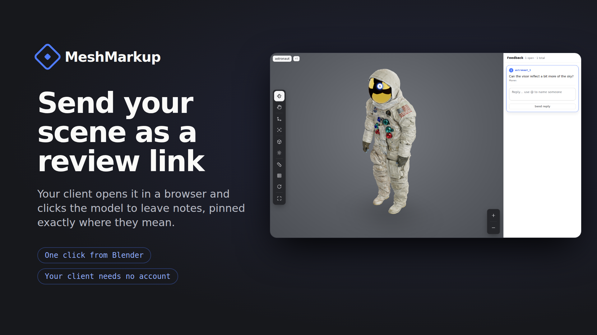

<p align="center"></p>

# MeshMarkup for Blender

Send your Blender scene to a client as a 3D review link. Your client opens it in any browser, turns the model and clicks the exact spot they want changed. No account or app needed on their side.



**Download:** [latest release](../../releases/latest) · **Website:** [meshmarkup.com/blender](https://meshmarkup.com/blender) · **Requires:** Blender 4.2 or newer

## Install

1. Download `meshmarkup-blender-1.0.0.zip` from [Releases](../../releases/latest). Don't unzip it.
2. In Blender, open **Edit → Preferences → Get Extensions**, click the **⌄** menu at the top right and choose **Install from Disk**, then pick the zip. Dragging the zip into the Blender window works too.
3. When Blender asks, turn on **Allow Online Access**. The add-on never connects to anything until you click one of its buttons.

## Use

Open the 3D view's sidebar (**N**) and the **MeshMarkup** tab, or **File → Export → MeshMarkup review link**.

1. **Connect** once. Blender shows a short code and opens your browser; sign in (or create a free account) and approve the code. Your password never goes through Blender.
2. **Send for review.** The scene, or only what you've selected, is exported as GLB with modifiers applied, uploaded, and a review link is copied to your clipboard. Paste it in an email or chat.
3. **Send the changes.** Fixed the notes? Click send again. The .blend remembers the model, so your client sees the new version on the same link, with their open notes still pinned in place.

**Export only** (no account needed): saves a review-ready GLB anywhere on your computer, for any other use.

## What is sent, and when

- Only when you click **Send for review**: the exported GLB and the name you give the model.
- Nothing at start-up, no telemetry, no automatic updates. Your device name isn't sent.
- Temporary files are written to Blender's own extension folder and deleted after sending.
- With Blender's **Allow Online Access** turned off, the add-on sends nothing and says so.

MeshMarkup has a free plan; [see the plans](https://meshmarkup.com/pricing). Your models are handled as described in the [privacy policy](https://meshmarkup.com/legal/privacy).

## Build from source

```
cd meshmarkup
blender --command extension build      # makes meshmarkup-1.0.0.zip
```

The add-on uses Python's standard library only. No external dependencies.

## Support

Something not working? [Report it here](../../issues), or through [meshmarkup.com/report-bug](https://meshmarkup.com/report-bug).

## License

GPL-3.0-or-later, as Blender add-ons are. See [LICENSE](LICENSE).
